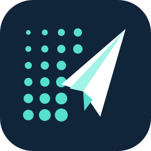

# RasterPilot

Vom Bild zum druckfertigen Halbtonraster.



RasterPilot ist als deutschsprachige Web-App geplant, die Fotos und Grafiken in Halbtonraster für DTF-Druckvorlagen umwandelt. Dabei entstehen Rasterpunkte mit transparenten Zwischenräumen. Die Anwendung soll auf Desktop und Tablet im Browser bedient werden und ohne GPU auskommen.

> **Projektstatus:** Vier Rastermodi einschließlich selektiver Rasterung für schwarze Shirts, transparenter PNG-Export, ein Hintergrund-Worker mit zehn Warteschlangenplätzen, eigene Auftragsliste und JSON-Einstellungen sind experimentell verfügbar. Druckkalibrierung und vollständige Betriebsabnahme stehen aus.

## Installation auf Debian 13

Für eine einfache Installation direkt aus GitHub und spätere Updates siehe die [Installationsanleitung](docu/INSTALLATION_Debian13.md).

## Lokal starten

Voraussetzung ist Python ab Version 3.11. Für den lokalen Entwicklungsstart:

```sh
python3 -m venv .venv
. .venv/bin/activate
pip install -e .
flask --app rasterpilot:create_app run
```

In einem zweiten Terminal im selben Projektverzeichnis den Worker starten:

```sh
. .venv/bin/activate
python -m rasterpilot.worker
```

Unter Windows entsprechend `.venv\Scripts\python.exe -m rasterpilot.worker` verwenden. Beide Prozesse müssen dasselbe Datenverzeichnis verwenden; Vorgabe ist `instance/jobs` im Arbeitsverzeichnis. Alternativ für beide `RASTERPILOT_DATA_DIR` setzen. Ohne laufenden Worker funktioniert der Import, eine Rasterberechnung wird mit einer verständlichen Meldung abgewiesen. `/health` prüft den Webprozess, `/ready` zusätzlich den Worker. Auf Debian starten beide Dienste automatisch; für bestehende Installationen die [Umstellung auf 0.4.0](docu/INSTALLATION_Debian13.md#update-auf-040-hintergrundverarbeitung) beachten.

Anschließend `http://127.0.0.1:5000` im Browser öffnen. Der Entwicklungsserver ist nicht für den Produktionsbetrieb vorgesehen. Tests lassen sich mit `python -m unittest discover -s tests` ausführen. Die Oberflächen-Zustandstests benötigen zusätzlich Node.js und laufen mit `node --test tests/test_ui.cjs tests/test_settings.cjs tests/test_queue_ui.cjs tests/test_tone_overlay.cjs`; die isolierten Installations-/Updatetests mit `node --test tests/test_install_scripts.cjs tests/test_services.cjs` benötigen außerdem eine POSIX-Shell (unter Windows Git Bash). Node.js wird für den Betrieb der Anwendung nicht benötigt.

Der aktuelle Ablauf importiert PNG/JPEG, berücksichtigt EXIF-Orientierung und Farbprofile und verarbeitet immer das vollständige Bild. Druckgrößenberechnung, vier Rastermodi mit einstellbarem Winkel (−180° bis +180°, Vorgabe 0°) sowie PNG-Export mit sRGB-Profil, binärem Alpha und ppi-Metadaten sind verfügbar. Im einfarbigen Modus lassen sich Druckfarbe, Umkehrung, Schwarz-/Weißpunkt und Gamma einstellen. „Schwarz durch Shirt ersetzen“ löst ab 0.6.0 den Affinity-Modus ab: Schwarz wird transparent, helle und kräftige Farbflächen bleiben geschlossen, Übergänge zu Schwarz erhalten aufgehellte Rasterpunkte. Nur Schwarz-/Weißpunkt sind als Tonwerte einstellbar; Vorgabe 0/245. Die gemittelte Bildwirkung auf Schwarz wird rechnerisch angenähert. Ab 0.8.0 zeigt eine zuschaltbare Live-Überlagerung geschlossene Bereiche grün, entfernte rot und Rasterbereiche gelb, direkt im Browser ohne neue Aufträge. Das Transparenzraster erhält deckende Motivbereiche. JSON-Version 4 speichert den Ansichtsschalter und importiert weiterhin Versionen 1–3. Originalvergleich, 100-%-Ergebnisansicht, Transparenzraster als Ansichtshilfe und Textilfarbe helfen beim Prüfen. Die [Bedienungsanleitung](docu/BEDIENUNG.md) erklärt die Schritte und Grenzen.

Bilder werden an den eigenen RasterPilot-Server übertragen, dort verarbeitet und für Hintergrundaufträge vorübergehend privat gespeichert; eine dauerhafte Projektablage gibt es nicht. Eingaben sind auf 20 MiB/40 Megapixel, Ausgaben seit 0.2.2 auf 40 Megapixel/12000 Pixel je Kante begrenzt. Midjourney-Hochformate mit 1904 × 2544 Pixeln funktionieren damit auch bei der Vorgabe von 28 cm Breite und 300 ppi ohne vorheriges Verkleinern. Die höhere Exportauflösung entsteht erst bei der Berechnung der Druckgröße. Der Rasterabstand muss mindestens zwei Ausgabepixel betragen. Ohne eingebettetes Profil gilt eine angezeigte sRGB-Annahme; unlesbare Profile und CMYK ohne Profil werden abgewiesen. Alle Druckeinstellungen sind unkalibriert, die Vorschau ist keine Druckfreigabe. Installationen von vor 0.2.0 benötigen für Uploads über 1 MiB die [Nginx-Anpassung für 0.2.0](docu/INSTALLATION_Debian13.md#bestehende-installation-auf-020-umstellen).

## Was soll RasterPilot können?

- PNG- und JPEG-Bilder importieren und vorhandene PNG-Transparenz erhalten.
- Vollständige Motive anhand von Druckbreite und Ausgabeauflösung mit erhaltenem Seitenverhältnis auf die benötigte Pixelgröße bringen.
- Farbige Motive gleichmäßig auflockern oder gezielt Übergänge zu Schwarz für schwarze Shirts rastern, einfarbige Halbtonmotive aus Helligkeitswerten erzeugen oder weiche Transparenz in Rasterpunkte umwandeln.
- Rastergröße, Winkel, Deckung und bei Bedarf Tonwerte einstellen sowie das Ergebnis mit dem Original vergleichen.
- Das Ergebnis mit Zoom, Transparenzraster und einer wählbaren Textilfarbe als Vorschau betrachten.
- In der Live-Tonwertüberlagerung bereits vollständig transparente Bildbereiche blau erkennen; die Markierung bleibt eine reine Ansichtshilfe.
- Ein transparentes PNG in der berechneten Druckgröße exportieren und Einstellungen als JSON speichern und wieder laden.
- Bis zu zehn aktive/wartende Aufträge einreichen. Unter der Vorschau eigene Originaldateinamen, Status und Warteposition sehen; fertige Ergebnisse bis zum Ablauf auch nach Neuladen anzeigen und herunterladen. Die Gesamtauslastung wird anonym angezeigt, fremde Dateinamen bleiben verborgen.

Die Textilfarbe dient nur der Vorschau und wird nicht in das Exportbild eingerechnet. Automatische Freistellung, weitere Punktformen, Stapelverarbeitung und eine NeoFab2-Anbindung sind für spätere Ausbaustufen vorgesehen.

## Wie ist die Verarbeitung geplant?

1. **Bild vorbereiten:** RasterPilot prüft und dekodiert die Datei, berücksichtigt Ausrichtung und Farbprofil und erhält vorhandene Transparenz. Das vollständige Bild wird ohne Zuschnitt verarbeitet.
2. **Druckgröße festlegen:** Aus Druckbreite und Ausgabeauflösung werden die Pixelmaße berechnet; das Seitenverhältnis bleibt erhalten. Die Auflösung beschreibt dabei das Bild und nicht die Hardwareauflösung des Druckers.
3. **Raster berechnen:** Je nach Modus bestimmen eine eingestellte Deckung, die Bildhelligkeit oder der Alphakanal die Rasterpunkte. Rasterabstand und Punktgröße werden in Bezug auf die spätere Druckgröße behandelt.
4. **Prüfen und exportieren:** Die Ergebnisansicht verwendet dieselbe PNG-Datei wie der Download; bei 100 % lassen sich die Exportpixel durch Scrollen prüfen. Der Export enthält sRGB-Farbprofil, transparente Zwischenräume und Auflösungsmetadaten. Der Alphakanal ist vollständig deckend oder vollständig transparent.

RasterPilot erstellt die Bildvorlage. Weißunterlegung, Farbseparation, Druckerprofil, gegebenenfalls Spiegelung und Druckeransteuerung bleiben Aufgaben der DTF-RIP-Software. Die Druckbreite sollte dort überprüft werden, da Programme Auflösungsmetadaten unterschiedlich auswerten können. Eine Vorschau ersetzt keinen realen Testdruck; Druckprofile gelten erst nach entsprechender Kalibrierung als geprüft.

## Geplante Umsetzung

Die Bildverarbeitung liegt unabhängig von Oberfläche und Webserver in `rasterpilot/processing`, damit derselbe Kern später auch in einer Desktop-App oder in NeoFab2 verwendet werden kann. Verwendet werden Python, Flask, NumPy und Pillow sowie HTML, CSS und JavaScript. Ein eigener Worker verarbeitet einen Auftrag gleichzeitig; SQLite verwaltet die begrenzte Warteschlange. Temporäre Originale und Ergebnisse liegen in einem privaten Datenverzeichnis und werden automatisch bereinigt. Signierte Sitzungscookies trennen die Aufträge verschiedener Browserzugänge. Dies ersetzt keine Anmeldung. Druck-, Raster- und Ansichtseinstellungen können ohne Bilddaten als versionierte JSON-Datei gespeichert und geladen werden.

Die Entwicklung ist in Etappen geplant:

1. **Grundgerüst:** Architektur, Roadmap, Versionsdatei und eine startfähige Oberfläche mit Health-Endpunkt.
2. **Import und Vorschau:** Bildimport, Transparenz, vollständiges Motiv, Druckgröße und Textilfarbvorschau.
3. **Erster vollständiger Ablauf:** Farbige Auflockerung, Rasterberechnung und PNG-Export.
4. **Weitere Rastermodi:** Helligkeits- und Transparenzraster sowie Tonwertkorrektur und erweiterte Einstellungen.
5. **Betriebsfähigkeit:** Worker, Ressourcenlimits, Zugriffstrennung, Bereinigung und JSON-Einstellungen.
6. **Kalibrierung:** Druckprofile, Prüfung kleiner Strukturen und Testvorlagen für reale Druckversuche.
7. **Debian-Betrieb:** Installations- und Betriebsanleitung mit systemd, Gunicorn und Nginx.

Als Zielumgebung ist ein eigener, unprivilegierter Debian-13-LXC unter Proxmox vorgesehen. Für den Einstieg sind 2–4 CPU-Kerne und 4 GB RAM angesetzt; der tatsächliche Bedarf soll gemessen werden. Uploads und temporäre Dateien sollen begrenzt und automatisch bereinigt werden.

Die ausführlichen Anforderungen und Abnahmekriterien stehen in der [Arbeitsanleitung](docu/RasterPilot_CODEX_Arbeitsanleitung.md).
