# Handout: Farbiges Halbtonraster in Affinity erstellen

Dieses Handout beschreibt den Arbeitsablauf der Screenshots: Ein farbiges Motiv wird anhand seiner Helligkeit in ein Punktraster umgesetzt. Das Raster dient anschließend als Maske für das ursprüngliche Farbbild. Die Zwischenräume werden transparent und können beispielsweise die Farbe des Textils zeigen.

**Prinzip:** Original duplizieren → Tonwerte und Schwarz-Weiß einstellen → Halbtonraster erzeugen → Raster als Maske verwenden → Ergebnis auf dunklem Hintergrund prüfen.

Die Menünamen beziehen sich auf die abgebildete deutschsprachige Affinity-Oberfläche. Je nach Version können Bezeichnungen und Positionen leicht abweichen. Die gezeigten Werte sind Ausgangspunkte, keine allgemeingültigen Druckwerte.

## 1. Motiv öffnen und Ebene duplizieren

1. Das gewünschte Bild in Affinity öffnen und im Bereich **Pixel** arbeiten.
2. Im Ebenenbedienfeld die Hintergrundebene auswählen und mit **Strg + J** duplizieren.
3. Die Kopie beispielsweise **Hintergrund HalbtonEbene** nennen. Das Original darunter bleibt als Farbquelle erhalten.

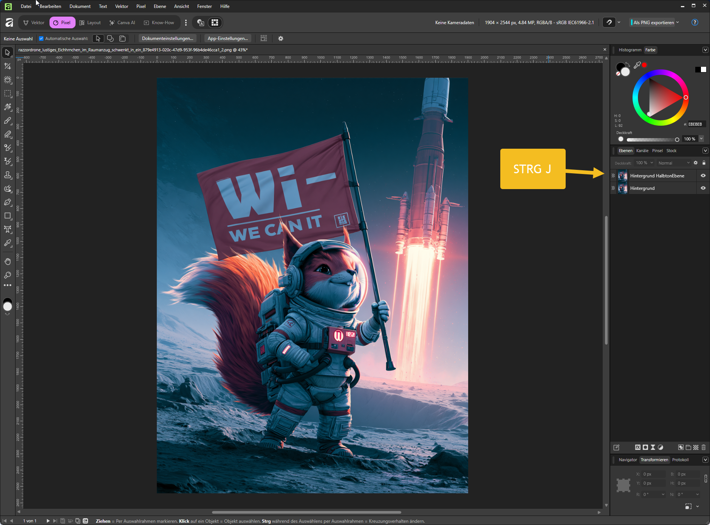

## 2. Tonwertkorrektur hinzufügen

1. Die duplizierte Halbton-Ebene auswählen.
2. Unten im Ebenenbedienfeld auf das Symbol für **Anpassungen** klicken und **Tonwertkorrektur** wählen.
3. Die Anpassung der Halbton-Ebene zuordnen. Mit Schwarzstufe, Weißstufe und Gamma lassen sich Schatten, Lichter und Mitteltöne für das spätere Raster beeinflussen.

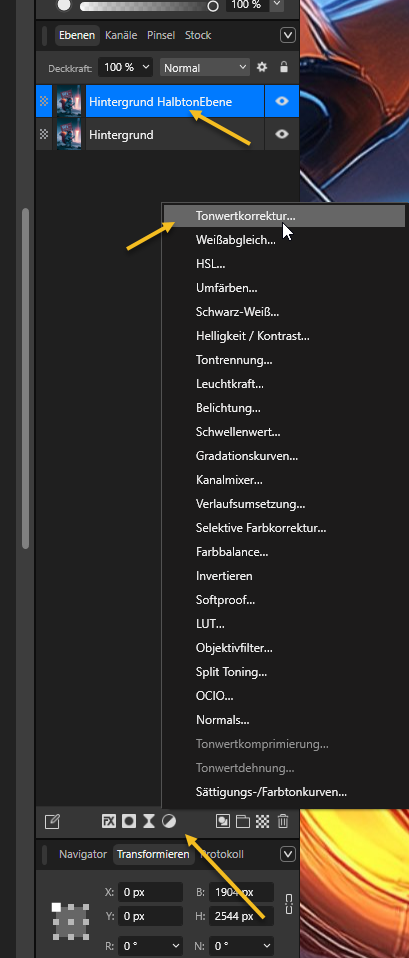

Der Dialog zeigt zunächst die neutralen Ausgangswerte: Schwarzstufe **0 %**, Weißstufe **100 %** und Gamma **1**. Die Ausgabewerte stehen ebenfalls auf **0 %** und **100 %**.

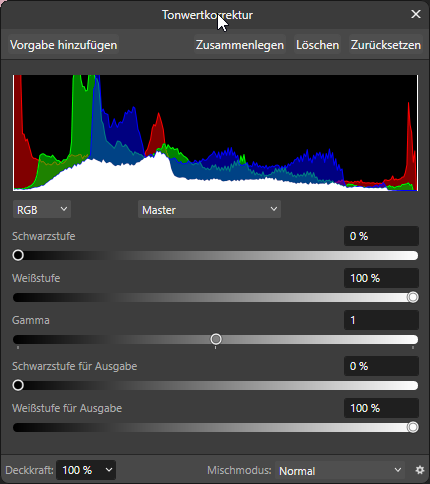

## 3. Schwarz-Weiß-Anpassung hinzufügen

1. Über das Anpassungsmenü zusätzlich **Schwarz-Weiß** wählen und ebenfalls der Halbton-Ebene zuordnen.
2. Die Farbregler bestimmen, wie hell die jeweiligen ursprünglichen Farben in der Schwarz-Weiß-Fassung erscheinen. Im gezeigten Ausgangszustand stehen alle Regler auf **100 %**.
3. Bei Bedarf einzelne Farben aufhellen oder abdunkeln, damit wichtige Motivdetails erhalten bleiben.

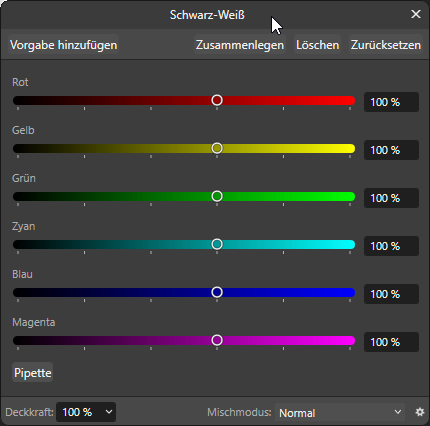

## 4. Halbtonraster anwenden

1. Die Halbton-Ebene auswählen.
2. Im Ebenenbedienfeld das Symbol für **Live-Filter** öffnen und **Halbtonraster** auswählen.

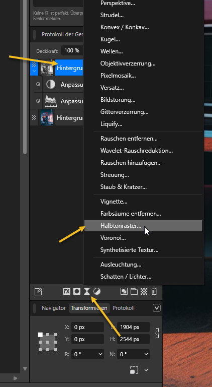

3. Im gezeigten Beispiel folgende Einstellungen verwenden:

| Einstellung | Beispielwert |
|---|---:|
| Raster | Monochrom |
| Punkt | Rund |
| Zellengröße | 10 |
| Kontrast | 85 |
| Rasterwinkel | 45° |
| Unbuntaufbau (GCR) / Unterfarbenreduktion (UCR) | jeweils 0 |

Die Zellengröße beeinflusst die Größe beziehungsweise den Abstand der Rasterelemente; der Winkel bestimmt die Ausrichtung des Rasters. Die passende Größe hängt von der endgültigen Druckgröße und der Ausgabe ab. Das Beispielbild hat **1904 × 2544 Pixel**; der Wert 10 ist deshalb nicht automatisch auf andere Dateien übertragbar.

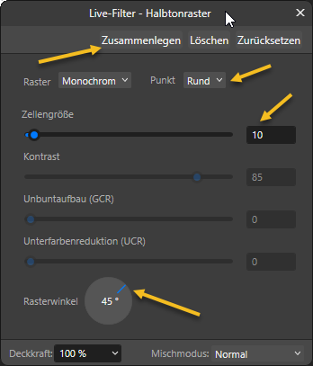

Der Screenshot markiert außerdem **Zusammenlegen**. Dieser Befehl übernimmt den Filter in die Ebene und schränkt seine spätere Bearbeitbarkeit ein. Eine bearbeitbare Arbeitsdatei vorher sichern; alternativ erst nach der Abstimmung des Rasters zusammenlegen.

## 5. Kontrast des Rasters abstimmen

Die Tonwertkorrektur erneut öffnen und das Ergebnis anhand heller und dunkler Bildbereiche beurteilen. Im Beispiel ist die **Weißstufe auf 72 %** gesetzt; Schwarzstufe und Gamma stehen auf **0 %** beziehungsweise **1**. Als Mischmodus der Tonwertkorrektur ist **Strahlendes Licht** zu sehen.

Diese Kombination ist eine motivabhängige Beispieleinstellung: Höhere Kontraste können Details in Lichtern oder Schatten verlieren. Regler und Mischmodus deshalb am eigenen Bild kontrollieren.

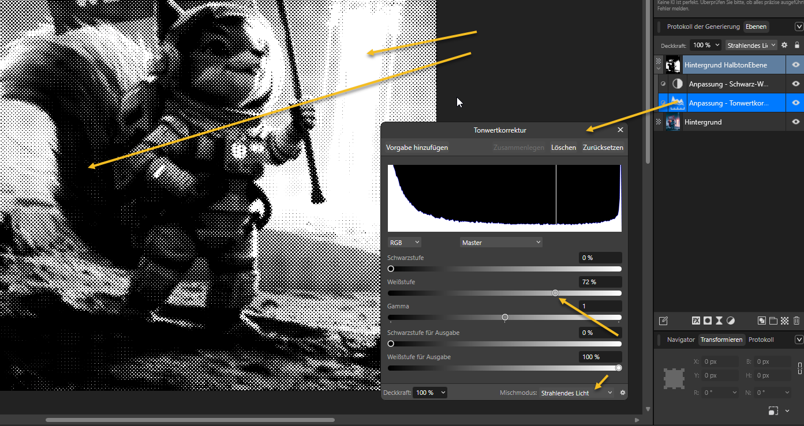

## 6. Halbton-Ebene rastern

Die Halbton-Ebene im Ebenenbedienfeld auswählen, das Kontextmenü öffnen und **Rastern…** wählen. Damit wird das sichtbare Ergebnis für die weitere Pixelauswahl in eine Pixelebene überführt. Vorher eine bearbeitbare Kopie speichern, da die bisherigen Anpassungen anschließend nicht mehr in gleicher Weise einzeln bearbeitbar sind.

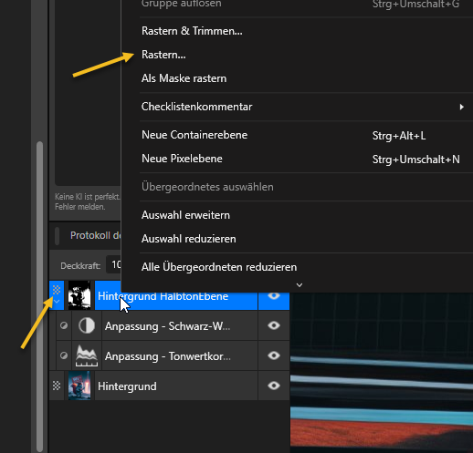

## 7. Lichter auswählen und Auswahl duplizieren

1. Die gerasterte Halbton-Ebene auswählen.
2. **Pixel → Pixelauswahl → Tonwertbereich → Lichter** wählen. Dadurch werden die hellen Bildbereiche für die folgende Bearbeitung ausgewählt.
3. Mit **Strg + J** den ausgewählten Inhalt auf eine neue Ebene kopieren und anschließend mit **Strg + D** die Auswahl aufheben.

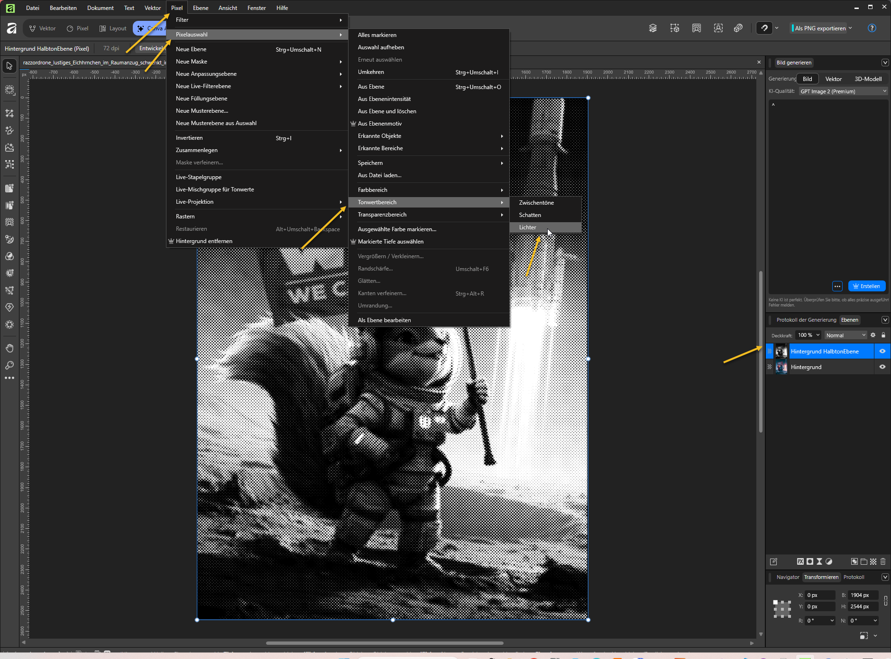

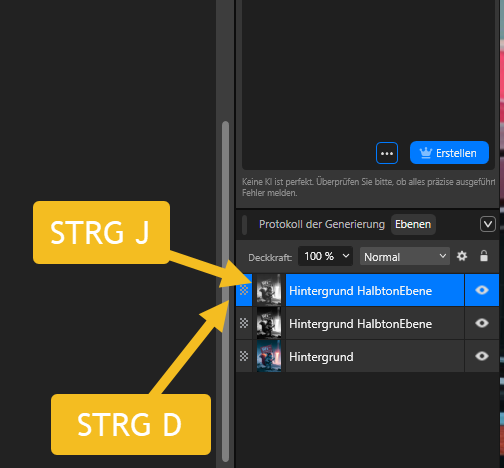

Die Screenshots zeigen die Lichterauswahl und danach zwei Halbton-Ebenen, aber nicht das Ergebnis jedes einzelnen Klicks. Falls die Maske später das Motiv umgekehrt ausspart, ihre Wirkung prüfen und gegebenenfalls die Maske invertieren.

## 8. Raster als Maske auf das Farbbild ziehen

1. Die neu erzeugte Rasterebene im Ebenenbedienfeld auf den **Maskenbereich** der ursprünglichen farbigen Hintergrundebene ziehen. Auf die Einrückung beziehungsweise Maskenposition achten: Die Ebene soll der Farbaufnahme als Maske zugeordnet sein.
2. Die separate Halbton-Ebene darüber ausblenden, damit das farbige, maskierte Original sichtbar wird.
3. Das Schachbrettmuster zeigt transparente Bereiche. Die verbleibenden Bildpunkte behalten die Farben des Originals.

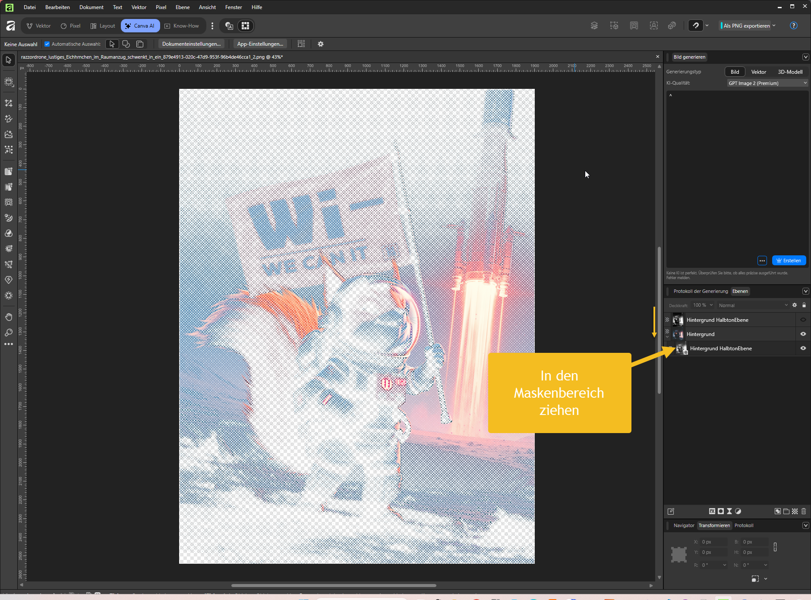

## 9. Auf dunklem Hintergrund kontrollieren und exportieren

1. Ein schwarzes Rechteck unter dem maskierten Farbbild anlegen. Es simuliert einen dunklen Untergrund und macht die Wirkung des Rasters sichtbar.
2. Bildwirkung, feine Punkte, wichtige Details und transparente Zwischenräume bei der vorgesehenen Ausgabegröße kontrollieren.
3. Die Arbeitsdatei mit Ebenen speichern. Für die Druckausgabe eine separate Kopie erstellen und darin alle ausgeblendeten Ebenen löschen. Anschließend beispielsweise als **PNG** exportieren und die Transparenz der exportierten Datei nochmals prüfen.

> 🚨 **DRINGEND VOR DEM DTF-DRUCK: ALLE AUSGEBLENDETEN EBENEN LÖSCHEN!**
>
> In der Druckdatei alle ausgeblendeten Ebenen vollständig entfernen – insbesondere Hintergrund- oder Testebenen, mit denen die Wirkung des Halbtonrasters auf einer bestimmten T-Shirt-Farbe geprüft wurde. **Nur ausblenden reicht nicht aus!** Andernfalls kann beim Drucken ein Hintergrund über das gesamte Bild entstehen, statt ausschließlich die nicht transparenten Motivbereiche zu drucken. Die Ebenen am besten in einer separaten Druckkopie löschen, damit die bearbeitbare Arbeitsdatei erhalten bleibt.

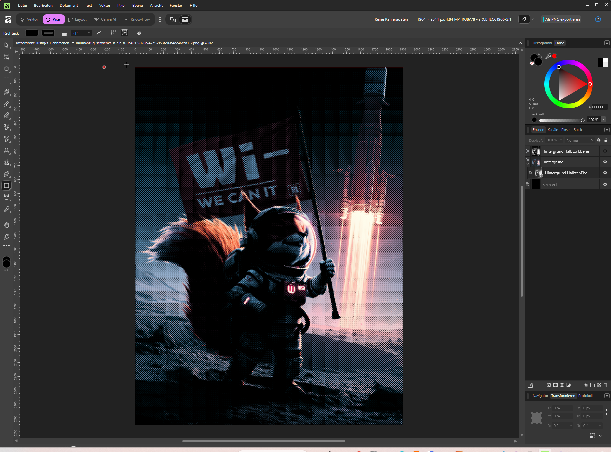

Für DTF empfiehlt sich ein Probedruck: Sehr kleine Punkte und Zwischenräume können je nach Drucker, RIP, Pulver und Textil anders ausfallen als auf dem Bildschirm. Auch die Weißunterlegung und die Dateivorgaben des Druckdienstleisters prüfen; das sichtbare Raster allein legt diese nicht fest.

## Kurzcheck

- [ ] Originalebene erhalten und bearbeitbare Arbeitsdatei gespeichert
- [ ] Tonwerte und Schwarz-Weiß-Umsetzung auf das Motiv abgestimmt
- [ ] Zellengröße und Rasterwinkel bei endgültiger Druckgröße geprüft
- [ ] Raster als Maske auf das farbige Original angewendet
- [ ] Transparenz und Wirkung auf der gewünschten Textilfarbe kontrolliert
- [ ] **Alle ausgeblendeten Ebenen, insbesondere Testhintergründe, aus der Druckkopie gelöscht – nicht nur ausgeblendet**
- [ ] Druckvorgaben und gegebenenfalls Probedruck geprüft

## Alternative zum Experimentieren: RasterPilot

[RasterPilot auf GitHub](https://github.com/know-how-schmiede/RasterPilot) ist eine experimentelle Web-App zum Erstellen von Halbtonrastern mit transparenten Zwischenräumen. Sie bietet eine Vorschau auf wählbarer Textilfarbe und PNG-Export. Die Druckkalibrierung steht noch aus; Einstellungen und Druckbarkeit vor einer Serie mit einem Muster auf dem vorgesehenen Textil prüfen.
